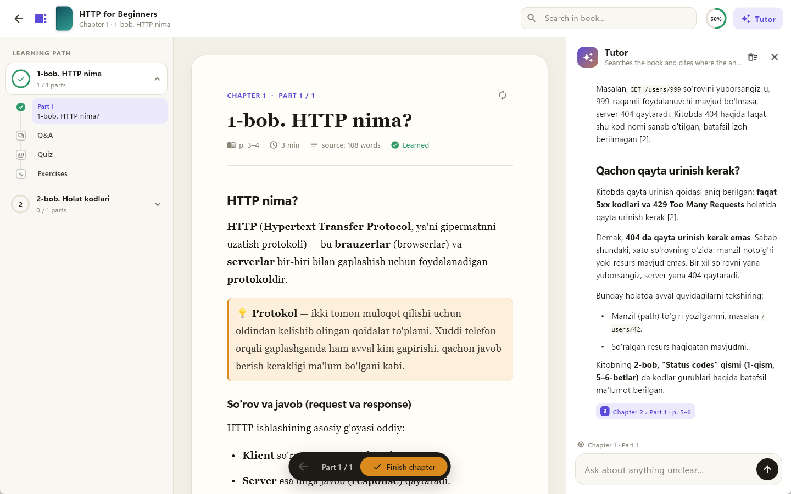
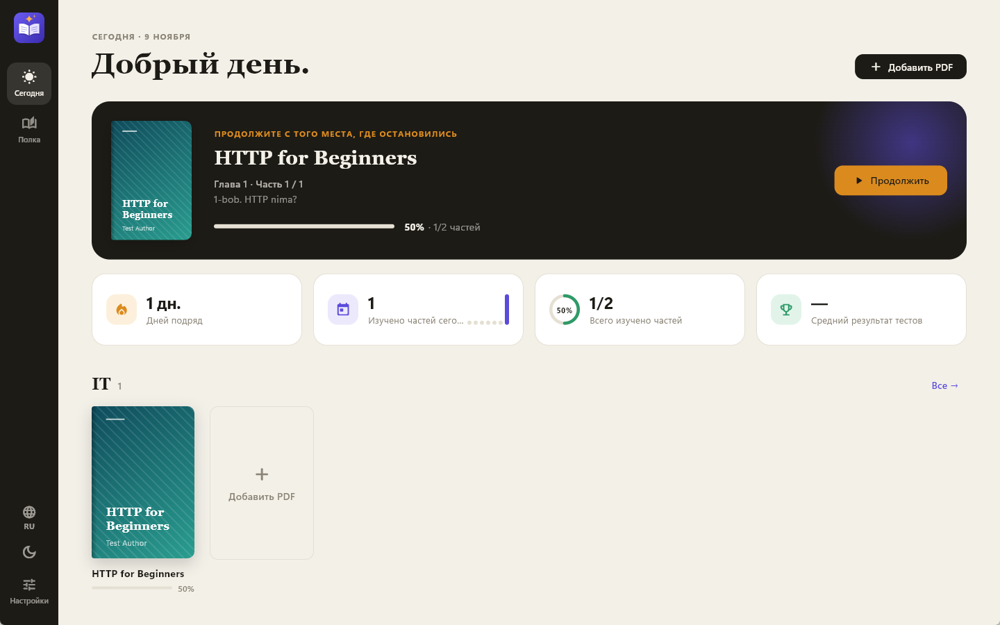
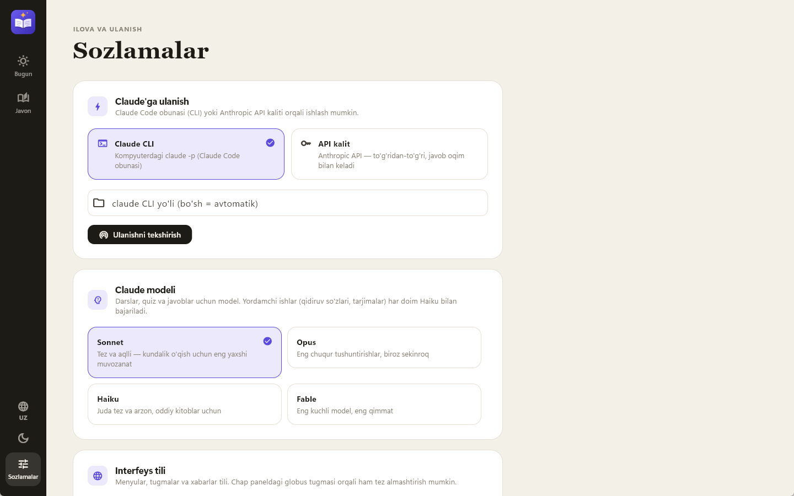

<p align="center">
  
</p>

<h1 align="center">Learner</h1>

<p align="center">
  <b>Turn any PDF book into a guided course — explained simply, in your language, with Claude.</b><br>
  Windows desktop app · Flutter · Interface in <b>O'zbekcha / English / Русский</b>
</p>

<p align="center">
  <a href="https://github.com/Alfraganus/learner/releases/latest"><b>⬇ Download for Windows</b></a> ·
  <a href="#ozbekcha">O'zbekcha</a> ·
  <a href="#русский">Русский</a>
</p>

<p align="center">
  
</p>

## What it does

Drop in a PDF and Learner:

1. **Extracts the text** page by page (in a background isolate).
2. **Detects chapters** with Claude (PDF bookmarks + page headings + table of contents).
3. **Splits each chapter into ~1,300-word parts** — no line of the source is skipped.
4. **Explains every part simply, without dropping anything**: key points, terms, and the original text side by side. Figures from the book ("Figure 1-4") are detected and shown right inside the lesson.
5. **Reinforces each chapter** with Q&A, a 10-question quiz and exercises that Claude grades.
6. **Tutor panel (RAG)** answers your questions from the book and cites *chapter, part and page* — click a source to jump there.
7. **Instant full-text search** inside the book (SQLite FTS5, works without Claude).
8. **Shelves & progress**: categories, "Continue where you left off", daily streak and quiz stats.

### Two languages, chosen separately

| Setting | What it controls |
|---|---|
| **Interface language** — globe button in the left rail, or Settings | Menus, buttons, messages, errors |
| **Learning language** — Settings | Lessons, quizzes, answers generated by Claude (whatever language the book is in) |

So you can read an English book, get explanations in Uzbek, and keep the interface in Russian.

<p align="center">
  
  
</p>

## Install

1. Download **`Learner-Setup-x.y.z-x64.exe`** from [Releases](https://github.com/Alfraganus/learner/releases/latest).
2. Run it (no admin rights needed — it installs per user; Windows 10/11 x64).
3. Open **Settings → Connect to Claude** and pick one:

| Mode | How it works |
|---|---|
| **Claude CLI** | Uses `claude -p` from your Claude Code subscription. Prompt via stdin, structured answers via `--json-schema`. |
| **API key** | Anthropic Messages API over HTTP with streaming (SSE); structured outputs via JSON schema. The key is encrypted with Windows DPAPI. `ANTHROPIC_API_KEY` env var also works. |

Models: Sonnet / Opus / Haiku / Fable (`claude-sonnet-5-5`, `claude-opus-5-5`, `claude-haiku-5-5`, `claude-fable-5-1`). Helper tasks (search keywords, title translation) always run on Haiku.

> Windows SmartScreen may warn because the installer is not code-signed yet: **More info → Run anyway**.

## How the RAG works

- The book is cut into ~200-word overlapping chunks (`rag_chunks`), each tagged with chapter, part and page.
- Generated lessons (in your language) are indexed too — an Uzbek question also finds the Uzbek lesson.
- Search uses SQLite **FTS5** (bm25, porter + unicode61); hits near the current part get a small boost.
- If the book is in another language, Haiku turns the question into keywords in the book's language and searches again.
- Retrieved chunks go to Claude numbered `[1]`, `[2]`…; the numbers in the answer become clickable source chips.

## Build from source

```bash
flutter pub get
flutter run -d windows
flutter test
```

Build the installer (needs [Inno Setup 6](https://jrsoftware.org/isinfo.php)):

```bash
powershell -ExecutionPolicy Bypass -File installer/build_installer.ps1
```

The setup file lands in `installer/Output/`. `LEARNER_DATA_DIR=<folder>` runs the app on a separate data folder (portable / demo).

Full pipeline with the real `claude -p` (import → chapters → lesson → quiz → RAG question):

```bash
RUN_CLAUDE=1 flutter test test/pipeline_test.dart
```

## Project layout

- `lib/l10n/strings.dart` — all UI strings in uz / en / ru (a test checks every key exists in all three)
- `lib/ui/theme.dart` — "Study Studio" design system (colors, type, light/dark)
- `lib/widgets/logo.dart` — the logo, drawn in code (`assets/logo.svg` is the same mark)
- `lib/db/` — SQLite schema (v2: RAG + FTS5), indexes, queries
- `lib/services/claude_service.dart` — CLI and API modes
- `lib/services/rag_service.dart` — indexing and search
- `lib/services/content_service.dart` — lessons, Q&A, quiz, exercises, tutor
- `lib/services/secret_store.dart` — API key storage with DPAPI
- `lib/screens/` — Today, Library, Settings, Reading studio
- `installer/` — Inno Setup script and build script

---

## O'zbekcha

**Learner** — istalgan PDF kitobni bosqichma-bosqich kursga aylantiradi. Kitob boblarga va ~1300 so'zlik qismlarga bo'linadi, har bir qism tanlangan tilda soddalashtirib (lekin hech narsa tashlab ketilmasdan) tushuntiriladi. Bob oxirida savol-javob, 10 savollik quiz va Claude baholaydigan mashqlar bor. **Ustoz** paneli savolingizga kitobdan qidirib javob beradi va qaysi bob, qism, sahifadan olinganini ko'rsatadi.

- **Interfeys tili** (chap paneldagi globus tugmasi) va **o'rganish tili** (Sozlamalar) alohida tanlanadi.
- O'rnatish: [Releases](https://github.com/Alfraganus/learner/releases/latest) sahifasidan `Learner-Setup-…-x64.exe` ni yuklab oling va ishga tushiring. Keyin *Sozlamalar → Claude'ga ulanish*: Claude CLI (Claude Code obunasi) yoki Anthropic API kaliti.

## Русский

**Learner** превращает любую PDF-книгу в пошаговый курс. Книга делится на главы и части по ~1300 слов, каждая часть объясняется простыми словами на выбранном языке — ничего не пропуская. В конце главы — вопросы и ответы, тест из 10 вопросов и упражнения, которые проверяет Claude. Панель **Наставник** отвечает на вопросы по книге и показывает главу, часть и страницу источника.

- **Язык интерфейса** (кнопка-глобус слева) и **язык обучения** (Настройки) выбираются отдельно.
- Установка: скачайте `Learner-Setup-…-x64.exe` на странице [Releases](https://github.com/Alfraganus/learner/releases/latest) и запустите. Затем *Настройки → Подключение к Claude*: Claude CLI (подписка Claude Code) или ключ Anthropic API.

## License

[MIT](LICENSE) © 2026 Gulomjon Sulaymonov
